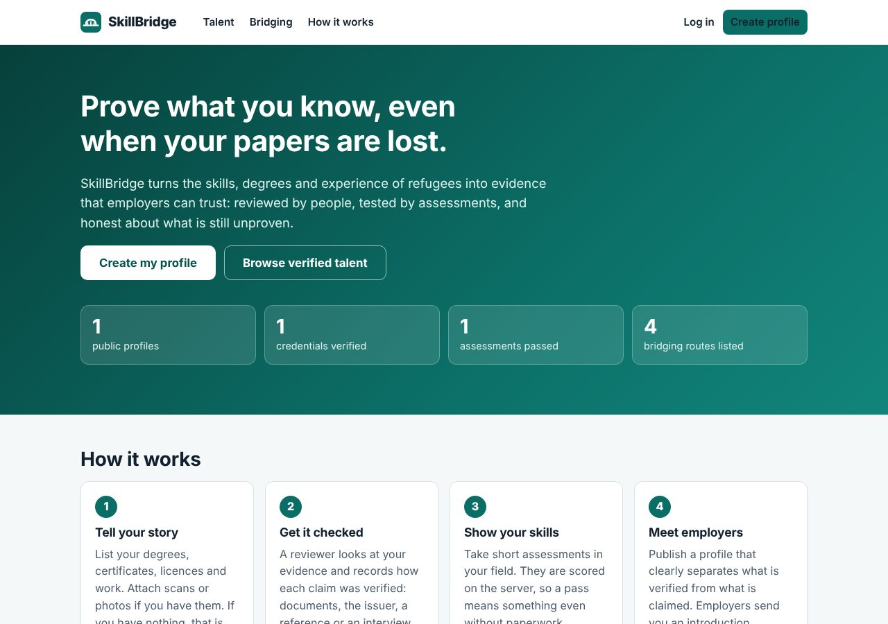
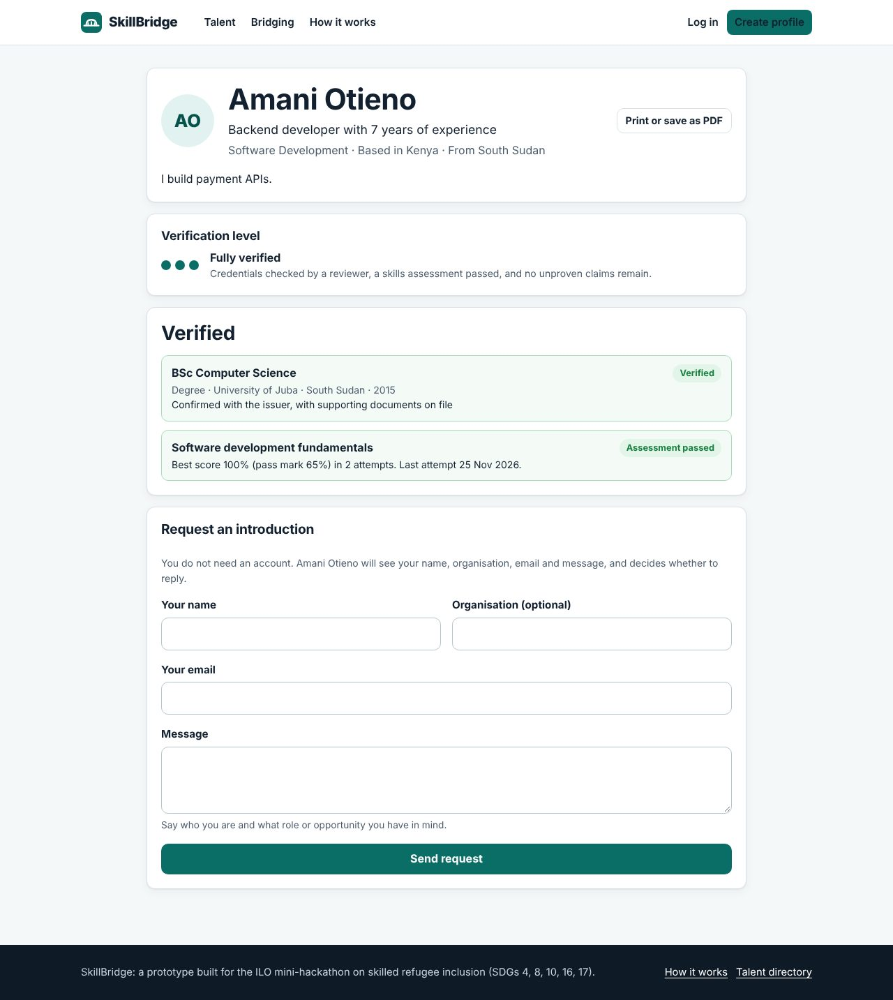
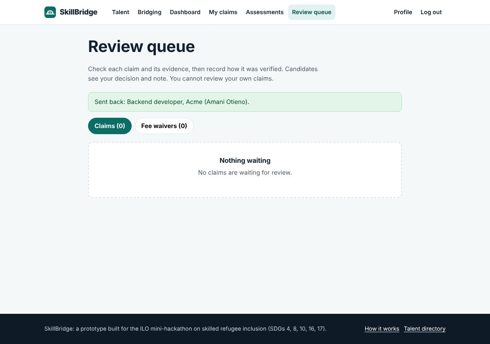

# SkillBridge

**Prove what you know, even when your papers are lost.**
SkillBridge helps skilled refugees turn degrees, licences and experience into evidence that employers can trust. A reviewer checks each claim and records *how* it was verified, skills assessments are scored on the server, and public profiles say plainly what is verified and what is still only claimed.

Built for the ILO mini-hackathon *"Unlocking Displaced Talent: Pathways for Skilled Refugees"* (Track 1: credential recognition and skills validation, with pieces of tracks 2 and 3).

- **Live app:** {{LIVE_URL}}
- **Repository:** {{REPO_URL}}
- **Project write-up and demo script:** [docs/SUBMISSION.md](docs/SUBMISSION.md)



## What it does

| For | Feature |
| --- | --- |
| Skilled refugees | Create a profile, list qualifications and experience (degree, certificate, licence, work), attach scans or photos as evidence, and send each claim for review. A claim can be sent with no files at all. |
| Skilled refugees | Take skills assessments in four fields. Scoring happens in the database, so a pass cannot be faked in the browser. Five attempts per assessment per day. |
| Skilled refugees | See a dashboard with a next-steps checklist, a verification level (0 to 3), routes to close the gap, and an inbox of introduction requests. |
| Skilled refugees | Browse bridging routes (certifications, credential evaluations, registrations) and request a fee waiver for the ones with partner funding. |
| Reviewers | A queue of pending claims with evidence (opened through links that expire after five minutes). Approve and record the method (documents reviewed, issuer confirmed, reference checked, interview) or send back with a note saying what is missing. Decide fee-waiver requests. |
| Employers and partners | Search the public talent directory by field and by whether anything is verified. Read a profile that separates **Verified** from **Claimed, not yet verified**. Send an introduction request with no account. |

| Public profile | Review queue |
| --- | --- |
|  |  |

*Screenshots come from the automated browser tests, which run against sample data.*

## Verification levels

| Level | Meaning |
| --- | --- |
| 0 Not yet verified | Nothing has been checked. Everything is the person's own account. |
| 1 Skills tested | At least one skills assessment passed. |
| 2 Credentials verified | At least one claim was verified by a reviewer. |
| 3 Fully verified | A claim verified, an assessment passed, and no unproven claims remain. |

## Tech stack

- **Frontend:** React 19, Vite 6, React Router 6, plain CSS (responsive, labelled form controls, visible focus states).
- **Backend:** Supabase (PostgreSQL with Row Level Security, Auth, private Storage). Business rules live in SQL: triggers, `SECURITY DEFINER` functions and policies. There is no separate server to run.
- **Hosting:** Vercel for the frontend, Supabase for everything else.
- **Tests:** Vitest unit tests for the pure logic, and SQL security tests that run against a real PostgreSQL (see below).

## Project structure

```
skillbridge/
├── src/
│   ├── lib/            api.js (every backend call), validation.js, trust.js (levels, suggestions), errors.js, *.test.js
│   ├── context/        AuthContext.jsx
│   ├── components/     Navbar, ProtectedRoute, ClaimCard, CredentialForm, Field, TrustLevel ...
│   ├── pages/          Home, Login, Register, Dashboard, ProfileEdit, Credentials, Assessments,
│   │                   AssessmentTake, Bridging, Talent, PublicProfile, Review, Impact
│   ├── App.jsx, main.jsx, index.css
├── supabase/
│   ├── schema.sql      tables, RLS policies, triggers, functions, storage bucket
│   ├── seed.sql        assessments, questions and bridging steps
│   ├── demo.sql        optional: four clearly fictional demo profiles
│   └── tests/security.test.sql
├── docs/               SUBMISSION.md and screenshots
├── vercel.json         single-page-app rewrite
├── README.md, DEPLOYMENT.md
```

## Run it on your computer

1. Create a free project at [supabase.com](https://supabase.com). In the SQL editor, paste and run `supabase/schema.sql`, then `supabase/seed.sql`. Optionally run `supabase/demo.sql` for fictional demo profiles.
2. Copy `.env.example` to `.env.local` and fill in the project URL and anon key (Supabase: Project Settings, API).
3. Install and start:

```powershell
npm install
npm run dev
```

4. To make yourself a reviewer, register in the app first, then run this in the Supabase SQL editor (change the email):

```sql
update public.profiles set role = 'reviewer'
 where id = (select id from auth.users where email = 'you@example.com');
```

Deployment steps are in [DEPLOYMENT.md](DEPLOYMENT.md).

## Tests

```powershell
npm test                      # unit tests: validation, trust levels, bridging suggestions, error messages
```

The database rules have their own test file. It builds people, claims, evidence and requests inside a transaction, checks that each rule holds, and rolls everything back:

```powershell
psql "$env:DATABASE_URL" -v ON_ERROR_STOP=1 -f supabase/tests/security.test.sql
```

It checks, among other things, that a candidate cannot verify themselves or become a reviewer, that evidence files are private, that the answer key never leaves the database, that attempts are limited, that rejected claims look like plain unverified ones in public, and that employers cannot read or tamper with introductions.

## Security and privacy

- Row Level Security on every table; candidates only ever read and write their own rows.
- Status changes, scoring, reviewer decisions and public profiles go through database functions or triggers, never through free-form updates from the browser.
- Editing a verified claim sends it back to unverified.
- Evidence lives in a private bucket (PDF, PNG, JPEG, WebP, 5 MB each, five files per claim) behind five-minute links.
- Profiles are private until published. Reviewer notes, rejections, files and email addresses are never public.
- Only the Supabase anon key is in the browser; it is designed to be public and is limited by the policies above.

## Limitations and next steps

The assessments are short knowledge screens, not licences, and fee-waiver availability stands in for partner funds. Next: reviewer organisations with their own queues, translations and a low-bandwidth mode, issuer confirmation by secure link, employer accounts, and anonymised reporting for partners.
